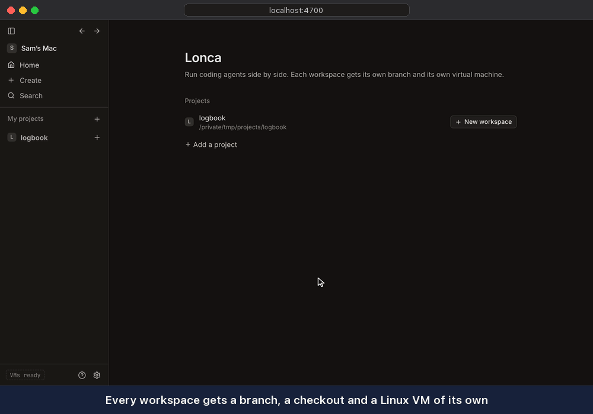

# Lonca

*Lonca* (pronounced lon-jaah) is a coordinator that lets you run a team of Claude, Codex and Gemini coding agents from your browser. Each workspace gets an isolated virtual machine to reduce security risks. No agent has direct access to Claude, Codex, Gemini or GitHub credentials.



Lonca means guild in Turkish, as in craftspeople working on separate pieces under one roof.

## Who is it for?

Lonca is for developers who already use Claude Code, Codex or the Gemini CLI (or potentially others) and want several agents working at once, with or without a lead, in a way that is as secure as possible. Each workspace runs in its own VM based on Docker Sandboxes. You can have a lead agent spin up others and assign tasks, review their work, approve or push back. But using a lead agent is optional, and if you wish, you can assign all tasks yourself. If you let the lead agent work through others, you can review and watch the interaction.

Lonca is influenced by [Conductor](https://conductor.build), a Mac app that works this way, with agents in git worktrees on your Mac. It differs in four ways that mattered enough for us to build it.

### Every workspace is an isolated VM

Each workspace is a Linux VM from [Docker Sandboxes](https://docs.docker.com/ai/sandboxes/), with its own kernel. It sees its own checkout and nothing else on your computer, and all the agents in the workspace share that VM. Because the VM is the boundary, it is safer to run Claude with `--permission-mode bypassPermissions`, Codex with `--dangerously-bypass-approvals-and-sandbox` and Gemini with `--approval-mode yolo`, and that's how Lonca runs them. Agents also get `sudo` and a Docker engine, but these are only inside the VM.

Claude, Codex, Gemini and GitHub credentials do not go into the VM. You can see this at the end of the demo above. Docker Sandboxes' proxy on your computer manages the credentials outside the VM, adding them to requests as they go out. See [How isolation works](docs/isolation.md) for the details.

### An optional Lead that can run a team

Each workspace opens with a Lead, and you can delegate entire tasks to it. It can do the work itself if it's small, or bring in agents on any Claude, Codex or Gemini model, each in a separate tab. For example, you could have Claude build and Codex review. The Lead reads their reports and sends work back if needed. It is accountable to you. You can also watch any agent and talk to it directly, so you have full visibility. Or you can direct the agents yourself, open additional conversations or close the Lead.

The Lead's playbook is customizable, and you can decide how you want the work to be done.

### Controlled from a browser

Lonca is just a small server with a web UI, so you can access it from anywhere if you want. We put it on an always-on machine and reach it with an SSH tunnel (over Tailscale works too), and you can have agents working while you close your laptop. Closing a tab doesn't stop an agent, and neither does restarting Lonca.

### Multiple sign-ins for each harness

If you use subscriptions for Claude, Codex or Gemini and have multiple subscriptions as we do, you can add them as separate sign-ins and balance the work across them. You can also have the lead continue the work for individual agents once their limits are over, or move them to another sign-in (as long as the lead is not hitting a limit itself).

## What else it does

Then there is the other stuff like terminals in every workspace, port forwarding between your host and VMs, etc. You can discover the rest yourself.

## Get started

So far, Lonca has been tested on a Mac with Apple silicon running macOS 27. It requires macOS 14 or later, [Node.js](https://nodejs.org) 22.18 or newer, git, and [Docker Sandboxes](https://docs.docker.com/ai/sandboxes/). Docker Sandboxes is free and needs a Docker account but not Docker Desktop. Docker Sandboxes also runs on Ubuntu 24.04 or later with KVM, so Lonca should work there too, but we haven't tested it yet.

```sh
brew trust docker/tap && brew install docker/tap/sbx
git clone https://github.com/itemir/lonca.git
cd lonca
npm install
npm start
```

Lonca opens in your browser. After that:

1. **Sign in to Docker** in Settings, or run `sbx login`. Lonca then builds the workspace template. It takes a few minutes the first time.
2. **Sign in to Claude, Codex, Gemini or several**, with a subscription, a Google account or an API key. The home page walks you through it. To let agents push and open pull requests, connect GitHub in Settings.
3. **Add a project:** a GitHub repository (`owner/repo` or a URL), or a folder on your computer. If it needs installing, give it a setup script in its settings, such as `npm install`.
4. **Press + next to the project** to create a workspace, and tell its Lead what you want done.

To reopen Lonca later, run `npm start` again. The link it prints contains an access token, and your browser remembers it after the first visit. To update, run `git pull` and `npm install`, then restart it.

## Some reminders

- Your sign-ins stay out of the VM, but anything in a workspace can still use them. It can push wherever your GitHub token can and spend your Claude, Codex and Gemini usage. It can also send your code anywhere on the internet, and read the variables in the project's settings. So give GitHub a fine-grained token without Administration or Workflows permission.
- A workspace's checkout is a folder on your computer. Running git or an editor there runs config an agent could have written, so treat it like a repository from a stranger.
- Workspaces start with nothing from your computer. Your own Claude, Codex and Gemini settings, skills and MCP servers aren't there, and a project that only builds on macOS, like an iOS app, can't build in one.
- Each workspace can grow to about 30 GB of disk, and it can use up to half your computer's memory unless the project sets limits. A team of agents also burns through your plans' usage faster.
- At this point, Lonca is for one person and only listens on `127.0.0.1`. To run it on one computer and use it from another, start it there with `LONCA_NO_OPEN=1 npm start`, then connect with `ssh -L 4700:127.0.0.1:4700 <that computer>`, keeping the same port at both ends.

## Learn more

- [Using Lonca](docs/guide.md): the Lead, sign-ins, project settings, ports, archiving, disk space, configuration and removing Lonca.
- [How isolation works](docs/isolation.md): what keeps workspaces apart, and what they share.
- [Development](docs/development.md): running from source, the tests, and how Lonca is put together.

## License

[MIT](LICENSE)
